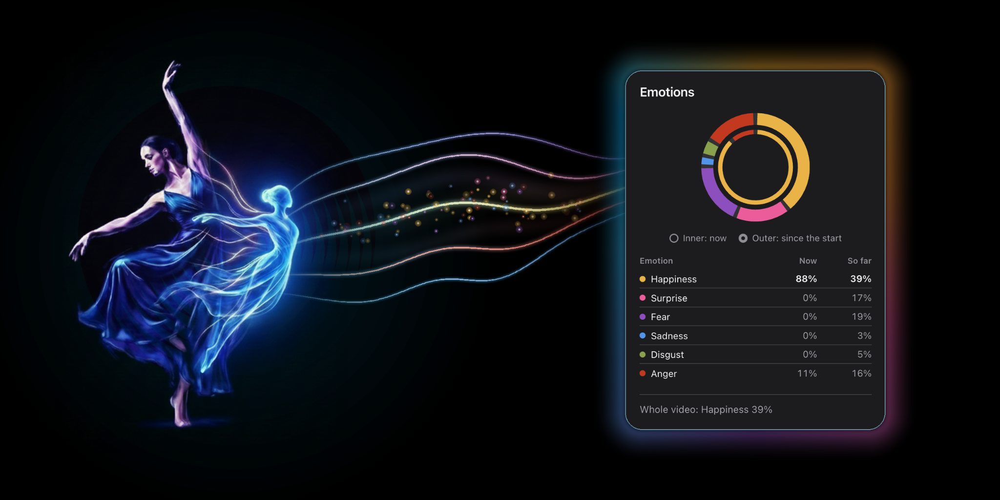

<h1 align="center"></h1>

<p align="center">Recognize <strong>Ekman's six basic emotions</strong> (happiness, sadness, anger, fear, disgust and surprise) from how a person moves in an ordinary video.</p>

<p align="center">
  <a href="#use-the-dashboard"></a>
  <a href="https://pytorch.org/"></a>
  <a href="LICENSE"></a>
  
</p>

<p align="center">
  
</p>

The core of this project is its architecture: a dual-stream Transformer that learns emotion from body movement, combining 3D pose estimation with expressive features from Laban Movement Analysis.

The models of this project learned from one reference dataset of contemporary dance, performed by a specific dancer. Their predictions are therefore not an absolute truth about what someone feels. They show how closely a movement resembles the way emotions are expressed in that dataset, and another dancer or dance style may express the same emotion differently.

That's why this repository includes everything needed to train the same architecture on your own reference:

- **A training pipeline** that turns dance videos into 3D skeletons and movement features, then trains and evaluates models on them.
- **A web dashboard** that runs the whole chain with your model, on any video you upload.

The trained models of this project are not included, because they learned from private recordings (see [Data](#data)).

## Highlights

- **One RGB camera is enough.** No motion-capture suit, markers or depth sensor.
- **Robust pose extraction.** Every video goes through four preprocessing passes; for each frame the most reliable skeleton is kept, then cleaned by quality control.
- **Two complementary views of movement.** The 3D skeleton (33 MediaPipe landmarks) and six features inspired by Laban Movement Analysis (LMA) that describe body shape, level and movement energy.
- **Dual-stream Transformer.** One encoder per input stream, fused by a classification head (6.4 M parameters).
- **Interactive dashboard.** Drop a video and watch the predicted emotions change while it plays, with the detected skeleton over the video if you want it. Everything runs on your computer.
- **Tested on a reference dataset.** The best model, `dualstream-large-w50-s10-e100`, reached 71.0% accuracy and 69.7% macro F1 on the held-out test set. Read [Results](#results) before comparing these numbers.

## How it works (full training pipeline)

The system is a four-stage pipeline, where each stage produces the input of the next one.

<p align="center">
  
</p>

1. **3D pose estimation.** The video is sampled (one frame in four by default). [MediaPipe Pose](https://github.com/google-ai-edge/mediapipe) runs on four versions of each frame: unchanged, cropped around the person, denoised and sharpened, and with corrected lighting. For every frame, the version with the most visible landmarks wins, which gives a 3D pose of 33 landmarks.
2. **Quality control and denoising.** Gaps of up to 5 samples are filled by linear interpolation, joints that jump more than 0.38 m between two samples are clamped, and frames where fewer than 60% of the landmarks are usable are dropped.
3. **Feature extraction (LMA).** Six LMA-inspired features are computed per frame from the clean pose: share of visible body, body expansion, vertical level of the hips, hand and foot energy (speed), and torso inclination.
4. **Dual-stream Transformer and emotion classification.** Windows of consecutive samples (50 for the best model, or 4 seconds of video at 50 fps) slide over the clip. Each window goes through two Transformer encoders, one for the clean 3D pose and one for the LMA features; their pooled outputs are concatenated and classified. The clip prediction averages all its windows.

## Repository structure

```
emotion-recognition-from-movement/
├── training-pipeline/   # data processing, training and evaluation
│   ├── src/             # preprocessing, pose estimation, quality control, LMA features
│   ├── training/        # dataset, model, training and evaluation
│   └── configs/         # model and training configurations
├── dashboard/           # web app: upload a video, see the predicted emotions
│   └── models/          # your trained models (not versioned)
├── media/               # images used in the documentation
└── scripts/             # maintenance scripts
```

The dashboard is self-contained: it carries its own copy of the shared code, so it runs without the `training-pipeline/` folder once a trained model is in `dashboard/models/`.

## Train your own model

The [training pipeline guide](training-pipeline/README.md) walks through every step. In short:

```bash
git clone https://github.com/TaoufiQ-TbT/emotion-recognition-from-movement.git
cd emotion-recognition-from-movement/training-pipeline
```

1. Install the training pipeline: see [Installation](training-pipeline/README.md#installation). Run every step from this `training-pipeline/` folder.
2. Name your videos `<emotion>_<anything>.<ext>` and put them in `training-pipeline/assets/`. Each one should show one person with the whole body in view: see [Prepare the videos](training-pipeline/README.md#1-prepare-the-videos).
3. Extract poses and features: `python src/run_full_pipeline.py`
4. Build the train, validation and test splits: `python src/tools/build_emotion_dataset.py`
5. Train, for example with the settings of the best model: `python -m training.gesture.train_gesture --config configs/dualstream-large-w50-e100.yaml --window-stride 10`
6. Evaluate, then copy the model folder into `dashboard/models/` to use it in the dashboard.

## Use the dashboard

You need **Python 3.10, 3.11 or 3.12**, **[FFmpeg](https://ffmpeg.org/download.html)** and a model trained with the pipeline, copied into `dashboard/models/`. From the `emotion-recognition-from-movement/` folder:

```bash
cd dashboard
python3 -m venv .venv              # Windows: python -m venv .venv
source .venv/bin/activate          # Windows: .venv\Scripts\activate
pip install -r requirements.txt

python app.py
```

Open <http://127.0.0.1:8050>, choose your model in the sidebar, drop a video and wait for the analysis to finish. On the first analysis, MediaPipe downloads its pose model, so an internet connection is needed once.

**For a result you can trust, use a video of one person with the whole body in view.** See [Video requirements](dashboard/README.md#video-requirements) for what affects the result, and the [dashboard guide](dashboard/README.md) for details, settings and troubleshooting.

## Results

All models share the same data split and are evaluated on the same 31 test clips, one prediction per clip. Model IDs follow `dualstream-<size>-w<window>-s<stride>-e<epochs>`; `large` is `d_model` 256 with 4 layers, `small` is `d_model` 128 with 2 layers.

| Model | Accuracy (%) | Macro F1 (%) | Balanced accuracy (%) | Top-2 balanced accuracy (%) |
|---|---|---|---|---|
| **`dualstream-large-w50-s10-e100`** | **71.0** | **69.7** | **69.6** | 78.1 |
| `dualstream-large-w60-s15-e70` | **71.0** | 68.0 | 68.7 | **85.6** |
| `dualstream-large-w50-s10-e40` | 64.5 | 61.6 | 63.5 | 73.7 |
| `dualstream-large-w48-s16-e40` | 61.3 | 59.8 | 59.3 | 75.7 |
| `dualstream-large-w48-s12-e70` | 61.3 | 57.3 | 59.7 | 79.3 |
| `dualstream-large-w48-s24-e40` | 54.8 | 53.1 | 52.6 | 72.6 |
| `dualstream-small-w10-s10-e25` | 51.6 | 49.7 | 49.3 | 64.4 |
| `dualstream-large-w60-s10-e100` | 51.6 | 48.3 | 49.3 | 65.7 |
| `dualstream-large-w50-s25-e40` | 51.6 | 43.9 | 52.3 | 78.7 |

Chance level is 16.7% balanced accuracy. Top-2 counts a clip as correct when the true emotion is one of the model's two most likely emotions.

Scores per emotion of the best model, `dualstream-large-w50-s10-e100` (highest macro F1):

| Emotion | Precision (%) | Recall (%) | F1 (%) | Test clips |
|---|---|---|---|---|
| angry | 80 | 67 | 73 | 6 |
| disgusted | 75 | 75 | 75 | 4 |
| fear | 67 | 40 | 50 | 5 |
| happiness | 60 | 86 | 71 | 7 |
| sadness | 100 | 100 | 100 | 5 |
| surprised | 50 | 50 | 50 | 4 |

`fear` and `surprised` are the hardest emotions, and 4 of the 9 misclassified clips were predicted as `happiness`.

**How to read these numbers**

- **One dataset, one setting.** All clips come from one performer, recorded in one setting. Scores on other performers, camera angles, lighting or non-dance movement have not been measured.
- **The test set is small.** With 31 clips, one clip moves accuracy by about 3 percentage points, so differences of a few points are not meaningful.
- **The scores are likely optimistic.** Most performances were filmed from two views (front, and a back view where the dancer appears as a shadow), stored as two separate clips. The split was made per clip, so for 23 of the 31 test clips the other view of the same performance was in the training set. Expect lower scores on performances the model has never seen; a split by performance would give a stricter estimate.

## Data

The models were trained on a private dataset of 206 contemporary-dance clips: 104 performances, most of them filmed from two views. It mixes short gesture sequences, each focused on one emotion, with longer improvisations.

| Emotion | Gesture clips | Longer clips | Total |
|---|---|---|---|
| angry | 10 | 26 | 36 |
| disgusted | 8 | 21 | 29 |
| fear | 8 | 26 | 34 |
| happiness | 10 | 36 | 46 |
| sadness | 8 | 23 | 31 |
| surprised | 10 | 20 | 30 |
| **Total** | **54** | **152** | **206** |

**The videos, the data extracted from them and the models trained on them are not distributed**, to protect the performer's privacy: a model's weights are learned from its training data. To train on your own recordings, see [Prepare the videos](training-pipeline/README.md#1-prepare-the-videos).

## Responsible use

Emotion recognition is error-prone and sensitive. This project is meant for research on movement and emotion and for demonstrations. Do not use it to make decisions about people, for example in hiring, education, surveillance or health. In the EU, the AI Act prohibits emotion recognition systems in workplaces and educational institutions. Only analyze videos of people who agreed to it.

## Citation

If you use this code, please cite it. GitHub's **Cite this repository** button (generated from [`CITATION.cff`](CITATION.cff)) gives APA and BibTeX formats:

```bibtex
@software{tboubchat_emotion_recognition_from_movement_2026,
  author  = {T'Boubchat, Taoufiq},
  title   = {Emotion Recognition from Movement: a Dual-Stream Transformer on 3D Pose and Laban Movement Analysis},
  year    = {2026},
  url     = {https://github.com/TaoufiQ-TbT/emotion-recognition-from-movement},
  license = {MIT}
}
```

## Contributing

Bug reports and questions are welcome as issues. This repository does not accept pull requests, but you are free to fork it and adapt your own copy. See [CONTRIBUTING.md](CONTRIBUTING.md).

## About

This project started as my Master's thesis (MSc in Engineering, Data Science).

## License

The code is available under the [MIT License](LICENSE). The project builds on [MediaPipe](https://github.com/google-ai-edge/mediapipe), [PyTorch](https://pytorch.org/), [OpenCV](https://opencv.org/) and [Dash](https://dash.plotly.com/), which keep their own licenses.
