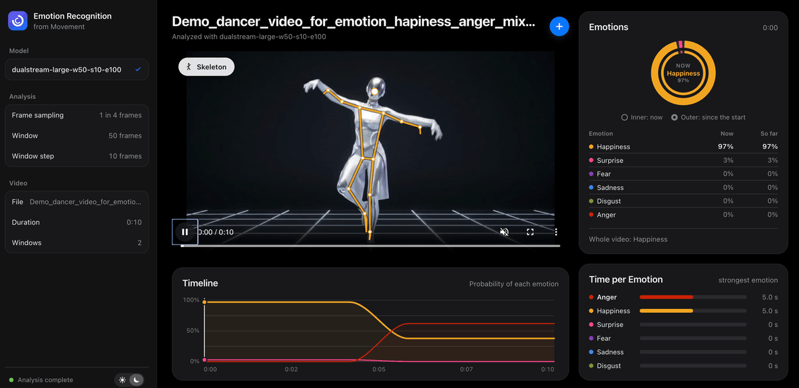

# Dashboard

Upload a dance video and watch the predicted emotions change while it plays. Everything runs on your own computer: your videos are never sent anywhere.

<p align="center">
  
</p>
<p align="center"><sub>Demo on a generated video, with a model trained on the private dataset of this project. The dashboard shows the model's reading of the movement, not the performer's actual feelings.</sub></p>

- [What you need](#what-you-need)
- [Installation](#installation)
- [Start the dashboard](#start-the-dashboard)
- [Video requirements](#video-requirements)
- [Analyze a video](#analyze-a-video)
- [Models](#models)
- [Settings](#settings)
- [Your files and privacy](#your-files-and-privacy)
- [Troubleshooting](#troubleshooting)
- [For developers](#for-developers)

## What you need

- **Python 3.10, 3.11 or 3.12**. Check with `python3 --version` (Windows: `python --version`).
- **FFmpeg**, to read and convert videos:

  | System | Install |
  |---|---|
  | macOS | `brew install ffmpeg` ([Homebrew](https://brew.sh)) |
  | Debian, Ubuntu | `sudo apt install ffmpeg` |
  | Windows | Download a build from [ffmpeg.org](https://ffmpeg.org/download.html) and add its `bin` folder to your `PATH` |

  Check with `ffmpeg -version`.
- **A trained model**. None is included: see [Models](#models).
- About 2 GB of free disk space for the Python packages.
- An internet connection for the installation and the first analysis.

## Installation

Run these commands once, from the `dashboard/` folder.

```bash
python3 -m venv .venv              # Windows: python -m venv .venv
source .venv/bin/activate          # Windows: .venv\Scripts\activate
pip install -r requirements.txt
```

## Start the dashboard

```bash
source .venv/bin/activate          # Windows: .venv\Scripts\activate
python app.py
```

Then open <http://127.0.0.1:8050> in your browser. Stop the dashboard with `Ctrl+C` in the terminal.

## Video requirements

A model works best on footage similar to its training videos: the models of this project learned from contemporary dance filmed with one dancer. The dashboard always gives an answer when it finds a body, so a bad video can still produce a confident result. Follow these points to get a result you can trust:

| | Use | Otherwise |
|---|---|---|
| **People** | One person in the frame | The pose tracker follows a single person and can jump between several people, mixing their movements. The dashboard cannot detect this, and the result is meaningless |
| **Framing** | The whole body in view, and not too small in the frame | With the legs out of view the result can change, and the dashboard shows a notice. A very small person may not be detected at all |
| **Image** | Steady camera, good lighting, sharp image | The pose gets noisier, often without any error. Turn on **Skeleton** to check that it follows the body well |
| **Length** | At least one analysis window, shown as **Window** in the sidebar (4 seconds for the best model of this project) | A shorter clip fills only part of an analysis window, and the dashboard shows a notice. There is no maximum length, but processing time grows with the video |
| **Frame rate** | Any | Videos are sampled at the rate the model was trained at (12.5 frames per second for the best model of this project), so a window lasts the same time at any frame rate |
| **Format** | Any format FFmpeg can read, up to 300 MB | An unreadable file stops with an error message |

The model is sensitive to small changes: encoding the same video at another quality can change the result of a window. Analyzing the same file twice gives the same result.

## Analyze a video

1. **Choose a model** in the sidebar, among the folders in `models/` (see [Models](#models)). The first one in alphabetical order is selected by default.
2. **Drop a video** anywhere on the window, or click **Choose Video…**. Files up to 300 MB are accepted, in any format FFmpeg can read (MP4, MOV, AVI…).
3. **Wait for the analysis.** The page shows each step: the upload, "Prepare video" (conversion to MP4, so your browser can play it), "Detect body pose" (four passes), "Analyze movement" and "Recognize emotions".
   - On the first analysis, MediaPipe downloads its pose model, which needs an internet connection once.
   - It takes time: about 5 to 7 seconds of processing per second of video on a laptop CPU (measured on an Apple M1 Pro), so about half an hour for a 5-minute video. This is only a rough guide: it can be faster or slower depending on your computer and on what else is running on it.
4. **Play the video.** Everything follows the playback:

   | Card | Shows |
   |---|---|
   | **Emotions** | Two rings and a table. The inner ring (**Now**) shows the emotion probabilities at the current moment, the outer ring (**So far**) their average since the start of the video. Below them, the model's prediction for the whole video |
   | **Timeline** | One curve per emotion, from 0 to 100%. Click or drag on it to jump to a moment |
   | **Time per Emotion** | How long each emotion was the strongest one |

   The whole-video prediction uses the same method as the [published results](../README.md#results): it averages the model's raw scores over all windows. The rings average probabilities instead, to show the mix of emotions. The two usually agree, but on a close call the largest share of the outer ring can differ from the whole-video prediction.

   Under the prediction, a **Less reliable** notice appears when the clip is shorter than one window, when the person is found in less than half of the video, or when the hips and legs are mostly out of view. The notice for the legs is based on the dataset of this project: every one of its clips shows more of them than that. Other problems, such as a second person, are not detected.

Three controls are always at hand:

- **Skeleton**, at the top left of the video, draws the detected body pose over the video.
- **+**, next to the title, starts a new video.
- The **sun and moon switch**, at the bottom of the sidebar, changes between dark (the default) and light. Your browser remembers the choice.

The sidebar shows the settings of the selected model:

| Setting | Meaning |
|---|---|
| **Frame sampling** | Frames analyzed per second of video, the same rate as when the model was trained |
| **Window** | Number of analyzed frames the model looks at once, and how long that lasts |
| **Window step** | Number of analyzed frames between the start of two windows |

Switching to another model after an analysis reuses the extracted poses, unless the new model was trained at a different sampling rate; then the video is analyzed again.

## Models

No trained model is included: the models of this project learned from private recordings, so they are not distributed. Their test scores are in the [main README](../README.md#results).

**To add your model**, train it with the [training pipeline](../training-pipeline/README.md), copy its whole folder (`checkpoint.pt` and `config.yaml`) into `models/`, then refresh the page. There is no need to restart the dashboard, but the refresh clears the analysis on screen.

Every folder in `models/` that contains a `checkpoint.pt` appears in the model list in the sidebar.

## Settings

The dashboard reads three optional environment variables:

| Variable | Default | Effect |
|---|---|---|
| `PORT` | `8050` | Port of the web page |
| `HOST` | `127.0.0.1` | Network address the server listens on. The default allows only your own computer. |
| `DEBUG` | off | `DEBUG=1` turns on automatic reload and the Flask debugger, for development |

```bash
PORT=8080 python app.py                 # macOS / Linux
$env:PORT=8080; python app.py           # Windows (PowerShell)
```

> **Security:** keep the default `HOST`. With `HOST=0.0.0.0`, anyone on your network can open the dashboard and upload files to your computer. Never combine it with `DEBUG=1`, because the debugger can run code.

## Your files and privacy

- Videos and results stay on your computer. The only network access is the one-time download of the MediaPipe pose model.
- Each uploaded video is stored in `uploads/<job>/`, and its poses, features and predictions in `runs/<job>/`. Delete these folders when you no longer need them. Both are ignored by git.
- The list of analyses is kept in memory: restarting the dashboard clears it, but not the files on disk.
- Only analyze videos of people who agreed to it.

## Troubleshooting

**"FFmpeg was not found"**
FFmpeg is missing or not on your `PATH`. Install it (see [What you need](#what-you-need)), open a new terminal, and check `ffmpeg -version`.

**"No model is selected"**
`models/` has no model. Copy a trained model folder into it, with its `checkpoint.pt` (see [Models](#models)), then refresh the page.

**"… is larger than 300 MB"**
Shorten or compress the video, for example: `ffmpeg -i input.mov -vf scale=-2:720 -c:v libx264 -crf 23 output.mp4`

**`Address already in use`**
Another program uses port 8050. Start the dashboard on another port: `PORT=8051 python app.py`.

**"This file could not be read as a video"**
The file is damaged or is not a video. Check that it plays in a video player, or convert it: `ffmpeg -i input.mov -c:v libx264 output.mp4`

**"No person was detected" or "Too few frames with a visible person"**
The body was not found in the video, or it was found too rarely. Check that one person is clearly visible and not too small in the frame (see [Video requirements](#video-requirements)).

**`pip install` fails**
Check your Python version: 3.10, 3.11 and 3.12 are supported. The pinned MediaPipe version does not install on newer Python versions.

## For developers

The dashboard is self-contained: `src/` and `training/` are copies of `training-pipeline/src/` and `training-pipeline/training/`. Edit the code in `training-pipeline/`, then run `python scripts/sync_dashboard.py` from the repository root. See [CONTRIBUTING.md](../CONTRIBUTING.md).

| File | Role |
|---|---|
| `app.py` | Web interface (Dash) and upload routes |
| `jobs.py` | Background analysis jobs |
| `pipeline.py` | Video conversion, pose estimation, blending, quality control, features, prediction and quality notices |
| `assets/dashboard.js` | Upload, live charts, skeleton overlay and theme switch, in the browser |
| `assets/styles.css` | Interface styles |
